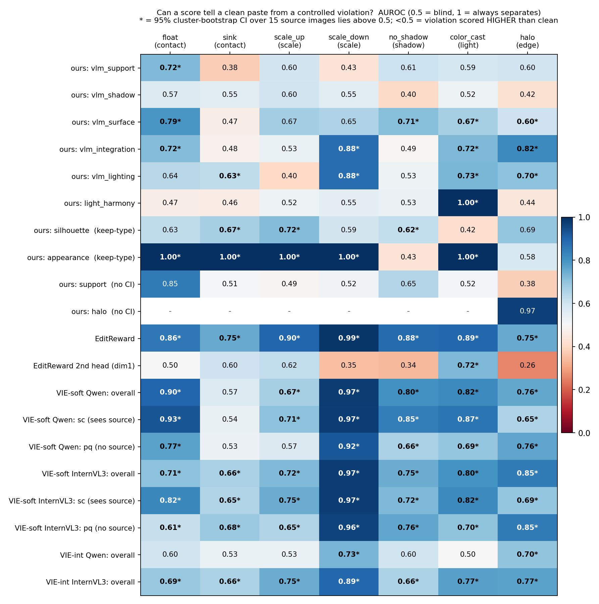
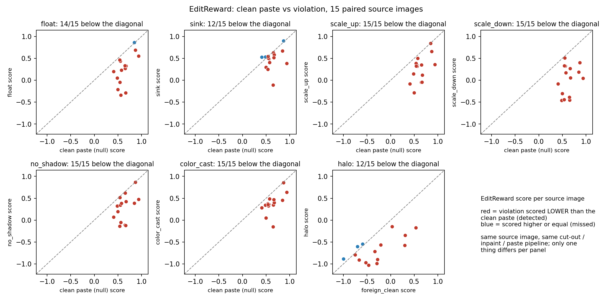
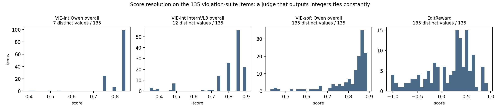
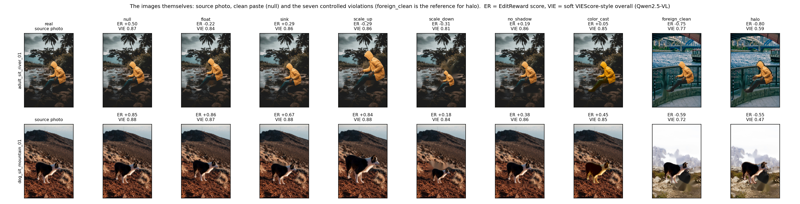
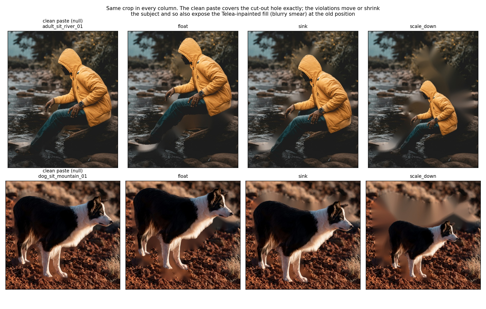

# 通用 reward model 基线在违例集上的结果

*日期：2026-11-05。数据：CHTC 上的 `rw_vio_vie`（Qwen2.5-VL-7B）、`rw_vio_vie2`（InternVL3-8B）、`rw_vio_er`（EditReward-Qwen2.5-VL-7B），
各 135 项（15 张源图 × 9 种变体），没有空值。我们自己的 critic 用的是 `runs/e1v2`（10/02 的 v2 critics，没有用 v3 重跑）。
图：`docs/img/reward_fig1…5`，脚本：`experiments/plot_reward_figures.py`，协议见 `docs/specs/2026-11-05-reward-baseline-and-vlm-variance.md`。*

## 一句话

**在这套违例集上，通用 reward model 不是“看不出”：EditReward 对 7 类违例的 AUROC 都在 0.75–0.99，95% CI 下界全部高于 0.5。**
原先的主张 A4（“通用 reward 看不出物理错误”）在这里不成立。但这套违例集本身有混杂（见“要先承认的问题”），所以也不能反过来说 EditReward 懂物理。

## 数据

AUROC 0.5 = 完全看不出，1 = 总能分开干净粘贴与违例；`*` = 按 15 张源图做 cluster bootstrap 的 95% CI 下界 > 0.5。

| 违例 | EditReward | 我们最好的 critic（E1 v2） | 备注 |
|---|---|---|---|
| float | 0.86* | support 0.85（无 CI）、vlm_surface 0.79* | 接近 |
| sink | 0.75* | silhouette 0.67*（保持型）、vlm_lighting 0.63* | 我们没有真正的“下沉”检测器 |
| scale_up | 0.90* | silhouette 0.72* | |
| scale_down | 0.99* | vlm_integration 0.88*、vlm_lighting 0.88* | 见混杂 |
| no_shadow | 0.88* | vlm_surface 0.71*、support 0.65 | vlm_shadow 0.40、contact_shadow 0.33，反向 |
| color_cast | 0.89* | light_harmony 1.00* | 我们的专用检测器更强 |
| halo | 0.75* | halo critic 0.97（无 CI） | 我们的专用检测器更强 |

- EditReward 逐图配对：float 14/15、sink 12/15、scale_up 15/15、scale_down 15/15、no_shadow 15/15、color_cast 15/15、halo 12/15 的违例得分低于干净粘贴（fig2）。
- **我们的接触/阴影类 critic 仍然是弱项**：`vlm_shadow` 对 no_shadow 是 0.40，`vlm_support` 对 sink 是 0.38。EditReward 在 no_shadow 上 0.88。
- `appearance` 在 5 类上是 1.00，但那是保持型指标对“主体位置、颜色变了”的反应，不是物理判断。

### VIEScore 风格 judge：整数版几乎看不出，软分数版可用

- 整数版 Qwen 的 overall 在 135 项里只有 7 种取值，99 项都是 0.8485，所以大量打平，AUROC 在不少格子里恰好 0.50（如 color_cast）。
  InternVL3 整数版有 12 种取值。
- 软分数版（读 0–9 数字 token 的概率取期望）有 135 个不同取值，AUROC 大多在 0.65–0.97。软分数版是看到冒烟结果里打平之后才加的，
  我当时说明了两版并列报告；现在数据显示整数版基本不可用，软分数版才是有效基线，但“看完结果才选”这一点要在论文里写明。
- 带源图的子分（sc）在 Qwen 上普遍高于不带源图的（pq）：float 0.93 对 0.77，no_shadow 0.85 对 0.66，color_cast 0.87 对 0.69。
  InternVL3 上则相反或持平（sink、scale_down、halo 的 pq 不低于 sc）。**两个 VLM 不一致，不能当作结论。**

## 要先承认的问题（这决定了上面的数字能说什么）

1. **移动或缩小主体会露出补背景留下的涂抹。** 干净粘贴把抠掉主体后留下的洞正好盖住；float、sink、scale_down 把主体挪开或缩小，
   旧位置的 Telea 补全就露了出来（fig5 里清晰可见，尤其 scale_down）。所以 float / sink / scale_down 上的高 AUROC，
   既可能来自“物理上不对”，也可能来自“看见涂抹”。无源图的 pq 子分在 scale_down 上也有 0.92–0.96，说明涂抹本身就足以被发现。
   **这对我们自己的 critic 同样成立**（如 vlm_integration 对 scale_down 的 0.88）。
2. **所有违例都是“相对源图发生了变化”，干净粘贴不是。** EditReward 和 VIEScore 的 sc 都能看到源图，
   它们可能是在检测“和源图不一致”，不是在判断物理合理性。
3. **违例集的指令是通用的**（“把主体放进场景，使结果看起来自然、物理合理”），违例图并没有换背景，这对依赖指令的 reward model 有影响。
4. **15 张源图、约 30 列 × 7 类，没有做多重比较校正。** CI 是按源图的 bootstrap，但个别 `*` 在校正后不一定站得住。
5. 我们的 E1 AUROC 来自 10/02 的 v2 critics，没有用当前 critics 重跑；有 CI 的只是那些 15 张图都有分数的 critic，`support`、`halo` 只有点估计。

## 对论文主张的含义

- A4 要改写。不能再写“通用 reward 看不出物理错误”。可以写的是：**在这套违例集上，通用 reward 能分开违例，但违例集有位移和涂抹混杂，尚无法证明它们是在判断物理**。
- 我们的真实差异点集中在：专用的 halo / light_harmony 检测器更强；接触、阴影类 critic 目前不如 EditReward（no_shadow）。这与 E1 的负结果一致，没有新的好消息。
- 如果要保住“评测论文”的卖点，下一步应当先修违例集，让“物理错误”与“位移 / 涂抹”可以分开。

## 下一步（建议，成本从低到高）

1. **加一个位移匹配的良性对照 `shift_side`**：把主体水平平移，位移量与 float 相同（高度的 10%），主体仍然在地面上。
   如果 EditReward 对 float 的 AUROC 明显高于 shift_side，才说明它在看物理；两者一样高，就是在看位移或涂抹。
   违例集生成只需 CPU，重新打分是三个小 CHTC 任务。
2. **统一补背景的区域**：让所有变体都露出同样大小的补全（或改用更干净的底图），把涂抹从变量里去掉。
3. 用当前 critics 重跑 E1，并给所有 critic 一套同样的 bootstrap CI。
4. 还没取回的两个任务：`vlmvar`（7839395，Qwen2.5-VL 全量稳定性）和 `vlmvar2_smoke`（7839391，InternVL3 的 P(Yes) 路径冒烟）。
